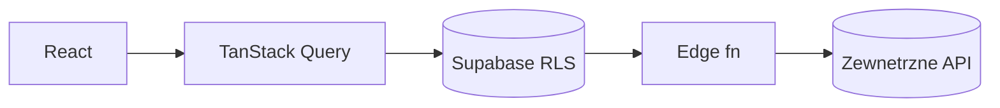

# ARCHITECTURE — mapa dla obcego (1 strona)

<!-- Cel: senior, ktory nigdy nie widzial repo, znajduje miejsce zmiany w 15 min. Aktualizuj przy kazdym ADR. -->

## Cel architektury
<!-- pg/design.md B.0. Czyta to `arch-check --brief` na starcie kazdej sesji (zespol = uzytkownik + agenci). Zastap <...>; placeholder = brak celu.
     Konflikt miedzy obszarami (cache vs spojnosc, koszt vs region) rozstrzyga WYZSZY priorytet; ADR podaje, ktoremu priorytetowi sluzy. -->
Cel: <jedno zdanie: co architektura ma umozliwic biznesowo, z liczba>
1. <priorytet nr 1 — atrybut jakosci + miara>
2. <priorytet nr 2>
3. <priorytet nr 3 (opcjonalnie)>
Swiadomie poswiecamy: <co jest gorsze, zeby 1-3 dzialaly>

## Co to jest (3 zdania)
- Dla kogo, jaki problem, jaki model biznesowy (kto placi).

## Stack (boring, z wersjami — z package.json)
- Frontend: … · Backend/DB: … · Hosting: Vercel / Lovable (edge fn NIE deployuja sie z git push) · Platnosci: … · Mail/SMS: …

## Moduly i granice (co jest gdzie)
<!-- Sekret (Parnas) = decyzja, ktora modul ukrywa, bo moze sie zmienic. Inne moduly jej nie znaja: nie wolaja
     `.from("<tabela>")` cudzego slice'a, nie importuja SDK dostawcy. Pusty sekret = modul bez kryterium podzialu.
     Karta: ~/.claude/skills/architecture-advisor/references/sd/01-fundamenty.md › Dekompozycja wewnatrz monolitu. -->
| Katalog | Odpowiedzialnosc | Sekret (co ukrywa) | Wejscie (public API) | Tier |
|---|---|---|---|---|
| `src/features/<x>` | … | schemat tabel `<x>` (zapytania tylko w `api.ts`) | `index.ts` | T2 |
| `src/integrations/<dostawca>` | adapter dostawcy (platnosci/SMS/mail/LLM) | wybor dostawcy i jego SDK | port (funkcje w `index.ts`) | T2 |
| `src/lib/<y>` | czyste funkcje domenowe (bez I/O) | regula biznesowa (cena, VAT, statusy) | … | T1 |
| `supabase/migrations` | schemat + RLS | — (przekrojowe: `org_id`, RLS = konwencja + bramka) | — | T3 |
| `supabase/functions` | edge fn (Deno) | protokol dostawcy webhooka | HTTP | T3 |

## Granice modulow — zalozenia ZAPISANE i egzekwowane (parsowane)

<!-- Blok ponizej czyta `node ~/.claude/bin/module-boundaries.js` (pre-push): warstwy od gory do dolu — plik z warstwy wyzej
     moze importowac warstwe nizej, nigdy odwrotnie; `forbid` = jawne zakazy; NOWY cykl importow = blok. To jest miejsce na
     „niepisane zalozenia architektoniczne" — jesli nie ma ich tutaj, kazdy kolejny diff moze je zlamac i nikt tego nie zobaczy.
     `owners` = tabela -> modul-wlasciciel (sekret z tabeli wyzej): `.from('<tabela>')` poza nim = ostrzezenie `SEKRET` w pre-push
     (observe, nie blok). Bez wpisu: ostrzezenie, gdy tabela jest znana w > `maxTableModules` modulach. Dostawcy: `vendors`
     dopisuje pakiety SDK do listy domyslnej, `adapters` = gdzie wolno je importowac. Stan calego repo: `--report`. -->

```json
{
  "pg.boundaries": true,
  "layers": ["src/routes", "src/features", "src/components", "src/lib"],
  "forbid": [
    { "from": "src/lib", "to": "src/integrations", "why": "functional core bez I/O: lib nie zna Supabase/fetch" }
  ],
  "maxFanIn": 40,
  "owners": {},
  "maxTableModules": 2,
  "adapters": ["src/integrations", "supabase/functions"]
}
```

## Przeplyw danych (diagram)


## Gdzie jest…
- autoryzacja: … (RLS + `org_id`)  · ceny/kwoty: … · i18n: … · logi: … · feature flagi: … · sekrety: env/Infisical

## Niezmienniki (Invariants) — czytaj PRZED planem zmiany
<!-- Reguly, ktore MUSZA byc prawdziwe zawsze; zmiana, ktora je lamie = design + ADR, nie poprawka w PR.
     Kazdy wiersz: regula + gdzie egzekwowana (test/constraint/RLS/kod) + co sie stanie, gdy padnie.
     Kto i kiedy: autor pierwszej zmiany T2+ (design w docs/designs/) wpisuje niezmienniki, ktorych ta zmiana dotyka;
     kazdy nastepny design dopisuje nowe. Pusta tabela przy T2+ = luka do uzupelnienia w tym samym PR.
     Dlaczego: agent planujacy zmiane nie zna regul, ktorych nikt nie spisal, i lamie je w dobrej wierze. -->
| Niezmiennik | Egzekwowane w | Skutek zlamania |
|---|---|---|
| PRZYKLAD — usun ten wiersz: kazdy wiersz danych klienta ma `tenant_id`; FK tylko w obrebie tenanta | RLS + test e2e | wyciek miedzy klientami |

## Decyzje nieodwracalne
Lista ADR: `docs/adr/` (kazdy z „dlaczego" i odrzucona alternatywa).

## Jak to cofnac / kill switch
- …
